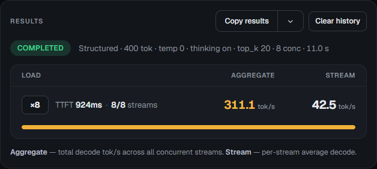
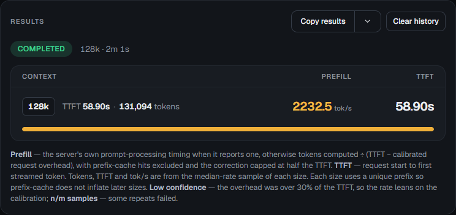

# DeepSeek on two DGX Sparks: measured stack and reproduction recipe

**v0.3.0 source preview, November 8, 2026.** The fourth ordered patch preserves a recently reused short snapshot against an older, deeper snapshot under cache pressure. In the saved SparkDash trial, all ten retention requests recalled correctly. The final short replay reused 75,776 of 76,048 input tokens with 473 ms time to first token in the UI. One 32K Native Quality control recovered 16/16 keys with zero stale values. A fresh deployment selected the same qualified image and both binaries after verifying startup and artifact equivalence. [Measured evidence](data/recency-results.json) · [artifact identity](data/build-identity.json) · [status and limits](REPRODUCTION-STATUS.md).

**v0.2 source preview, November 8, 2026:** complete prefix backing preserves reusable long histories after working KV rows are overwritten. In one matched three-stream 170K-context check, the measured follow-up wave fell from **168.110 s to 6.747 s**; including cold priming, the whole benchmark job took **40.06% less time**. Cold prefill was essentially unchanged. [Results and limits](RESULTS.md) · [pressure data](data/pressure-results.json) · [passive work data](data/live-work-results.json) · [credits](CREDITS.md) · [reproduction status](REPRODUCTION-STATUS.md).

Historical v0.1 observations remain **311.10 aggregate decode tokens/s** across eight short-prompt streams and **2,232.53 tokens/s** for calibrated zero-prefix-reuse 128K prefill. Those jobs used image `dac7945c…`; they were not rerun on v0.2 image `efceb406…`. [Original numeric data](data/results.json).

This repository publishes the ordered source overlays, external asset references, launch settings and benchmark procedures for these deployments. It contains no model weights, Keys sidecar, Engram tables, packed ranks, GPU bundles, credentials or host controllers. A clean rebuild has **not** been executed for this publication. Source closure and the build/launch commands are verifiable; binary equivalence and an independent reproduction remain unverified.

## What was measured

Two NVIDIA DGX Sparks, TP=2, one rank per node, with local Engram on both nodes. The checkpoint was Mia EAQ **v1** 2.9 bpw with drowzeys' matching Keys sidecar. The deployment had a **524,288-token shared pool**, **8 admitted lanes**, **32 internal streams**, **64 round rows**, **1 GiB prompt cache**, native drafting/graphs, thinking on and High effort. Eight lanes do not mean eight independent 524K contexts. The speed job used 58-token inputs and a 400-token output cap.

The historical speed image is identified in [v0.1 build identity](data/build-identity-v0.1.json); the historical full-prefix runtime is identified in [v0.2 build identity](data/build-identity-v0.2.json). Both were local images, with no public pull URL. Their history includes retained cache/API/tool/Engram repairs, TP2 capacity work, completion-first scheduling, finer snapshots and planned Engram read-ahead, followed by admission/cache repairs. Applying only the two focused upstream PRs to today's upstream does not recreate either runtime. v0.2 adds the refused-cut-in guard and complete independent prefix backing; it retains the same assets, quality settings, shared context, slots and 1 GiB snapshot budget. The recency overlay adds only the compact Store condition described below and has a separate current artifact identity.

## Saved SparkDash screenshots

These are historical v0.1 screenshots of the completed jobs, captured without rerunning them. They do not depict the new long-context pressure result.




## Exact source

Use Linux or a Linux filesystem in WSL. The upstream tree includes a fixture containing `?` in its filename, which cannot be checked out on NTFS. On a new clone:

```sh
git clone https://github.com/bertholomus/TensorFold.git tensorfold
git -C tensorfold checkout --detach fbbc97132cd004237d9887b8d3185896efaedc5c
git -C tensorfold apply --check ../patches/tested-stack.patch
git -C tensorfold apply ../patches/tested-stack.patch
git -C tensorfold apply --check ../patches/cache-cut-in.patch
git -C tensorfold apply ../patches/cache-cut-in.patch
git -C tensorfold apply --check ../patches/full-prefix-backing.patch
git -C tensorfold apply ../patches/full-prefix-backing.patch
git -C tensorfold apply --check ../patches/prefix-recency.patch
git -C tensorfold apply ../patches/prefix-recency.patch
python3 scripts/verify-source.py tensorfold
```

The current verifier targets the **1,117-file recency source closure**, digest `aa0f3dcdda5da77c13debb69ad4ac4fe1549518af54925ec3e7b80ab8441a041`. Apply all four patches in order. The full-prefix patch depends on the intervening cut-in guard in `lanes.zig`. Together the overlays modify 53 existing files and add seven. Keep the base checkout's license and notices. [Patch hashes, preimages and intermediate closures](data/patch-series.json) · [source inventory](patches/MODIFICATIONS.md).

For historical v0.2, stop after `full-prefix-backing.patch` and run `python3 scripts/verify-source.py tensorfold --manifest data/source-manifest-v0.2.json`; its closure remains `e6581809b03c00c99f79f090ee4891dda0f3ee1b7bbb0159b78f8d2454a80b8c`. The fourth patch changes only `zig/src/core/prompt_cache.zig`, from `c25bcb27…` to `8210b249…`; it does not change the budget, source-file count or peer protocol.

For historical v0.1 only, stop after `tested-stack.patch` and run `python3 scripts/verify-source.py tensorfold --manifest data/source-manifest-v0.1.json`; its closure remains `4df32ee4fc221d4e773542005750fd4fa411deed331ab2d8218fab5785eb85ce`. The old release and its measurements are preserved.

## Upstream bug fixes

Two independently reviewed draft PRs port the narrow fixes to the current `deepseek-v41-zig-tp2` branch:

- [#54: Preserve native DeepSeek snapshots when admission is rejected](https://github.com/bertholomus/TensorFold/pull/54)
- [#55: Scope ContextFull admission backoff to the refused request](https://github.com/bertholomus/TensorFold/pull/55)

Each includes a failing CPU regression and focused passing controls. Their full native-build/GPU qualification is pending and the draft bodies record local build limitations. The complete tested-stack overlay here already contains the original local versions of both repairs. The two PRs are separate ports to a newer upstream source; applying them alone does not recreate this measured image.

The latest independent-backing repair is submitted separately as [draft #56: retain complete packed prefix backing in prompt snapshots](https://github.com/bertholomus/TensorFold/pull/56). That public-API adaptation passes its overwrite regression, focused CPU controls and full-family semantic compilation; native-build/GPU qualification remains pending. The v0.2 ordered patches here reproduce the locally measured source; the separate public port is not itself qualified by those private-deployment measurements.

The fourth patch targets this recipe's older compact Store. Current public TP2 source at `e100ee8` uses a separate `prompt_cache_policy.zig` and branch-point protection when an extended entry is resumed. The same recency defect has not been reproduced against that newer public policy. PRs #54, #55 and #56 remain focused on their existing changes; the one-line recipe hunk is not presented as a qualified upstream port.

## External assets

Acquire assets from their authors under their own terms. Reuse an existing verified preparation where available. Asset preparation can download hundreds of GB and write large packed ranks; it is separate from a normal model start.

| Input | Exact public reference |
| --- | --- |
| EAQ v1 checkpoint | [Mia-AiLab/DeepSeek-V4.1-Flash-1017-EXL3-EAQ-v1-2.9-bpw](https://huggingface.co/Mia-AiLab/DeepSeek-V4.1-Flash-1017-EXL3-EAQ-v1-2.9-bpw/tree/45ee5d0fd106c94a3d77f721e09cbb2f50e5a16b), revision `45ee5d0fd106c94a3d77f721e09cbb2f50e5a16b` |
| Matching Keys | [drowzeys/keys-DeepSeek-V4.1-Flash-1017-Abliterated](https://huggingface.co/drowzeys/keys-DeepSeek-V4.1-Flash-1017-Abliterated/tree/de412d2249632903dace23399526e00a145aada5), revision `de412d2249632903dace23399526e00a145aada5`; `exl3_wo_b_l10_35_mia29.safetensors`, 682,275,992 bytes, SHA-256 `dcefb4a735f4985e4a5097cad69a059d85453f3bba148af3fc98269c7ee1ff7c` |
| Engram tables | [DeepSeek-V4.1-Flash-1017](https://huggingface.co/deepseek-ai/DeepSeek-V4.1-Flash-1017/tree/1bae0e1088993b9b82de08f59de5be5a34e42170), revision `1bae0e1088993b9b82de08f59de5be5a34e42170`, shards 47 and 48 |
| Base kit | [Bertholomus' TP2 recipe](https://github.com/bertholomus/deepseek-v4.1-tensorfold-tp2-2xgb10/tree/abe07c7d509a0199cc7fec15263be2aa52ac652f), `kit/` at `abe07c7d509a0199cc7fec15263be2aa52ac652f` |
| Capacity extension | [TP2 release](https://huggingface.co/bertholomus/DeepSeek-V4.1-Flash-TensorFold-TP2-2xGB10/tree/28550e066c262cfe9acd3655866f90b2415c6765), 48 K5120/N384 gate cubins for rows 17–64; exact paths/byte hashes are in [the extension manifest](scripts/AOT-CAPACITY-ROW-EXTENSION.json) |

The pinned [Mia preparation recipe](https://github.com/MiaAI-Lab/DeepSeek-v4.1-Flash-1017-2x-DGX-Sparks/tree/0e7d421eb4797d98dc781dad764b8f86d34118ae) documents [Keys application](https://github.com/MiaAI-Lab/DeepSeek-v4.1-Flash-1017-2x-DGX-Sparks/blob/0e7d421eb4797d98dc781dad764b8f86d34118ae/docs/abliterated.md) and [asset preparation](https://github.com/MiaAI-Lab/DeepSeek-v4.1-Flash-1017-2x-DGX-Sparks/blob/0e7d421eb4797d98dc781dad764b8f86d34118ae/scripts/prepare.sh). Its input-tools pin is `59402086381a42c74d53053443224eec2790b4c5`. Use EAQ v1, this exact sidecar, and stock F16 draft tensors; other quantizations or Keys variants are not interchangeable. The tested prepared Keys revision differs from that recipe's later default; the recorded sidecar SHA identifies the tested payload. Keys access is gated: use your own entitlement and authentication flow.

For a new preparation, first satisfy that recipe's hardware, Docker/NVIDIA, SSH, private-link, storage and NFS requirements. Clone it separately and use its supported preparation entry point with fresh operator-owned asset directories. The example addresses and paths below must be configured; this can build its preparation image, download assets, apply Keys and write both packed ranks. It does not start the serving pair:

```sh
git clone https://github.com/MiaAI-Lab/DeepSeek-v4.1-Flash-1017-2x-DGX-Sparks.git asset-prep
git -C asset-prep checkout --detach 0e7d421eb4797d98dc781dad764b8f86d34118ae
cd asset-prep
WORKER=operator@192.0.2.2 FABRIC_PEER=192.0.2.2 \
HF_CACHE=/your/assets/new-eaq-cache \
WORKER_CACHE_DIR=/your/assets/new-eaq-rank1 \
WORKER_ENGRAM_DIR=/your/assets/new-engram \
ABLIT=1 EAQ_V1_1=0 \
MODEL_REVISION=45ee5d0fd106c94a3d77f721e09cbb2f50e5a16b \
ABLIT_REVISION=de412d2249632903dace23399526e00a145aada5 \
ENGRAM_REVISION=1bae0e1088993b9b82de08f59de5be5a34e42170 \
bash scripts/prepare.sh
```

Use the directories and preparation manifest it reports to populate this recipe's runtime configuration. Its preparation image is not the measured serving image. For an existing installation, keep the known-good assets and verify compatibility instead of repeating preparation.

Once those 48 cubins are separately acquired, the existing staging helper validates their byte hashes, the base AOT manifest and variant collisions before creating a fresh sibling kit. Keep that sibling and the base kit together because it uses relative symlinks:

```sh
mkdir /your/assets/capacity
python3 scripts/stage_aot.py /your/assets/base/kit /your/acquired/cubins /your/assets/capacity/kit
```

It preserves 198 entries, adds 48 and must report AOT manifest SHA-256 `c492cacee86cb45787153b7e0d2b7708d7cc4ec65f09467a54b002e85de68803`. Mount both kits read-only at the same relative layout on both ranks. The extension includes metadata only; no cubin is hosted here.

## Build

The public source-build path uses ARM64 Linux, Zig 0.17.0, NVIDIA's PyTorch 26.07 base and CUDA `sm_121`. The [pinned Mia Dockerfile](https://github.com/MiaAI-Lab/DeepSeek-v4.1-Flash-1017-2x-DGX-Sparks/blob/0e7d421eb4797d98dc781dad764b8f86d34118ae/zig/Dockerfile) supplies the upstream command; TensorFold's `zig/build/cuda.zig` specifies each kernel's flags. The exact exported source's CUDA kernel files and that build helper match the public base pin.

After source verification, on an ARM64 builder:

```sh
docker build --tag local/deepseek-tested-source:recency-candidate .
```

[Dockerfile](Dockerfile) compiles the GPU bundles from public source and then builds both executables. It does not start the model. The saved v0.2 native rebuild passed using 21 retained GPU bundles and `-j1`; it was not a clean build of this public packaging. Its recorded command was:

```sh
/opt/zig/zig build -Dfatbins=/fatbins -Doptimize=ReleaseFast -j1 \
  install native fatbins --summary all --prefix /work/candidate-runtime
```

[Expected fatbin hashes](data/fatbins.json) identify those retained bytes. A fresh build may produce different bytes; neither matching source nor these instructions proves byte-identical binaries. Record the resolved base-image digest, `nvcc --version`, compiler hash and output hashes with your result. The base tag is the public toolchain reference; the original resolved NVIDIA parent digest is not established here.

The recency artifacts' separate native compilation also completed with the retained 21 GPU bundles. Its overall build observation nevertheless remains **FAIL**: during compilation, the existing memory watchdog stopped the serving head and normal recovery restored the selected predecessor. The watchdog cause was confirmed later; the compiled payload received separate COPY-only packaging approval. Compiler success and that approval do not establish serving continuity or a clean public rebuild. The later narrow UI qualification is recorded separately in [recency results](data/recency-results.json); it does not replace clean-public-build or broad GPU-parity proof. Both existing memory guards remain required.

## Launch

Use the two executables from the same updated build. **Both head and follower must be replaced together:** v0.2 changes peer snapshot save/restore messages, so this is not a head-only binary update. Adapt [runtime.env.example](config/runtime.env.example) on each rank, with local Engram and the proper rank cache. The [launch adapter](scripts/launch-rank.sh) uses the recorded native CLI and settings. It launches a single rank inside your existing container/service integration and supplies no pair controller, watchdog or recovery policy.

Keep the normal memory and thermal guards from your supported recipe, including both retained head and worker memory guards. The measured integration used Docker host networking/IPC, GPU access, `/dev/infiniband:rwm`, `IPC_LOCK`, unlimited memlock and a 64 MiB stack. Preserve those requirements and your own lifecycle ownership/stop behavior. The engine's 12.2 GiB allocation reserve is separate from the recipe's 2.5 GiB sustained/1 GiB emergency watchdog. The recency patch does not retire either guard or change those thresholds. Do not run a second pair over an existing one.

After the operator's integration creates the two containers with the verified runtime and read-only assets, launch the worker first and then the head in their respective containers:

```sh
bash scripts/launch-rank.sh worker /your/runtime.env
bash scripts/launch-rank.sh head /your/runtime.env
```

The API defaults to loopback. For a specific private API address, set `API_HOST` and a mode-600 `API_KEY_FILE`; the adapter refuses a non-loopback bind without one. No port-publishing or firewall rule is installed here. The rendezvous example uses RFC 5737 documentation space and must be replaced with the actual private CX7 address and device names. Connect SparkDash through your authenticated/private route, check pair readiness, then use its normal model controls.

## Repeat the benchmark in SparkDash

Save the model's source/asset/build pins and effective settings with both UI job exports and screenshots. Keep other work out of the measured interval through your ordinary controls, without cancelling it.

1. **Prefill:** select only the 128K preset. Use the built-in unchanged warmup/calibration and two-sample protocol: temperature 0, thinking off, eight-token output cap. Record actual token counts and native cached tokens for each measured sample. The published result had 131,094 prompt tokens and cached=0 in both samples. Report calibrated TTFT-derived prefill and the UI's lower-rate-of-two selection; do not call this backend-only prefill or a median of three. Zero prefix reuse with a resident model is the meaning of cold here.
2. **Decode:** choose exactly concurrency 8, Structured counting, Empty added context, output 400, temperature 0, top-k 20, thinking on. Record the full saved configuration; the deployment pool stays 524,288. Save aggregate and individual decode rates, first reasoning/content token, first answer token, completion counts and finish reasons. The published eight requests all reached `length`, so this is a capped speed observation.
3. **Record boundaries:** verify native cached=0, identify any unrelated completions, and record request errors, restarts, OOM, graph fallbacks and preemptions. Restore any temporary UI control change after the jobs. Do not run an extra standalone generator to duplicate the UI checks.

The separate v0.2 pressure protocol uses Structured/3/170000/400, temperature 0.7, top-k 20 and thinking on, with a cold 32K recall check before pressure and a warm recall check afterward. Save cold-primer, measured-wave and whole-job times separately, native prompt/cache counts and overwrite/budget evidence. [RESULTS.md](RESULTS.md) describes the saved paired comparison, salt difference and limits. Passive all-client reuse observations are a separate evidence source.

The recency artifacts completed one ten-request sequential hot-short protocol and one 32K Native Quality control through SparkDash. The retention sequence primes five other long branches, keeps a short A prefix, extends A, refreshes the exact short A request, applies cold C pressure and replays the exact short A request. It completed in 479.186 s (UI: 7m59s), with 10/10 correct recalls. Before C pressure, the cache log reported 950 whole MiB held as a conservative lower bound; C pressure recorded two budget evictions and one kept state. The final short replay still reused 75,776 tokens and the measured interval had no observed GPU/OOM errors or physical cache invalidations. The separate quality control completed in 17.807 s (UI: 17.8s), with 16/16 keys, zero stale values and cached=0. [Results and limits](RESULTS.md) · [recorded source/configuration and evidence](data/recency-results.json).

To repeat the recency protocol, use a monitored local TensorFold target with a compatible SparkDash overlay that provides **Hot-short cache retention: ten sequential requests**, fresh shared-pool capacity and native cached-token reporting. Select that control in the decode benchmark and save the full configuration, per-request recall, usage and displayed TTFT. The tested configuration uses Structured input, one sequential request at a time, High effort, thinking on, temperature 0.7, top-k 20 and output cap 400. Then run Native Quality with one 32K Long item at concurrency 1 and record correct and stale values. The saved Native Quality run used thinking off. Capture native cache counters around the C-pressure request and verify pair readiness before and after the jobs. The complete runnable overlay is a local prerequisite and its public reproduction remains unverified. The source hashes and exact observed settings are in the saved evidence. [Recency evidence](data/recency-results.json).

The historical trial qualified the artifacts before its deadline and closed through normal fallback after selection timing guards. Fresh startup later verified the same artifacts and settings for persistent selection with zero additional benchmark jobs or inference requests. [Selection observation](data/recency-results.json).

Static publication verification is recorded in [data/publication-checks.json](data/publication-checks.json). It is separate from the runtime evidence.
